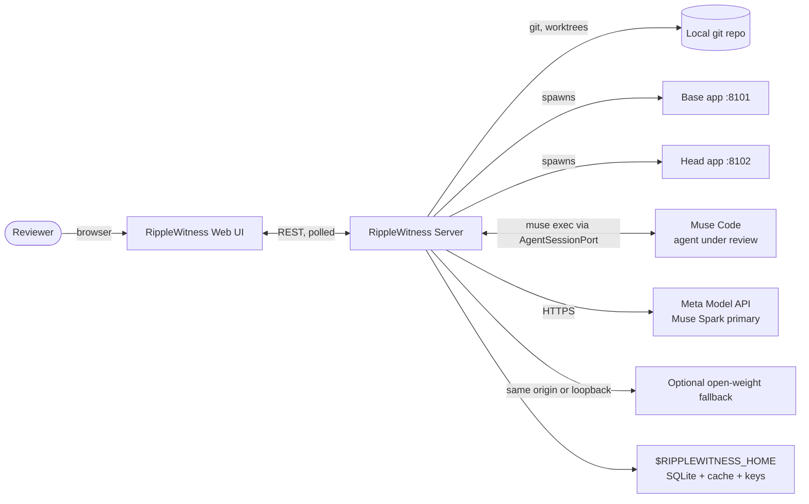
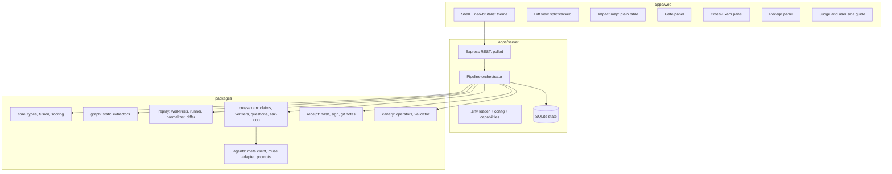
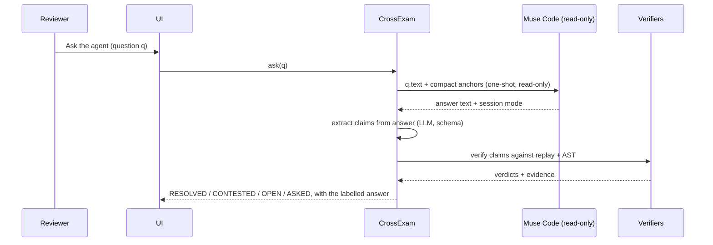
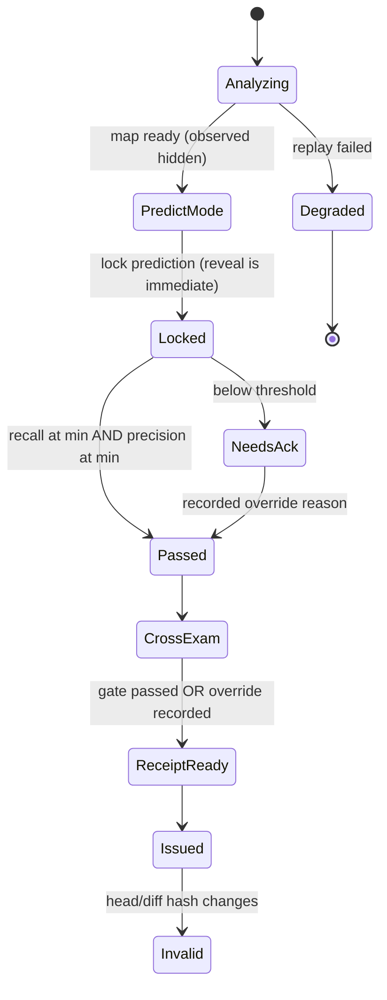
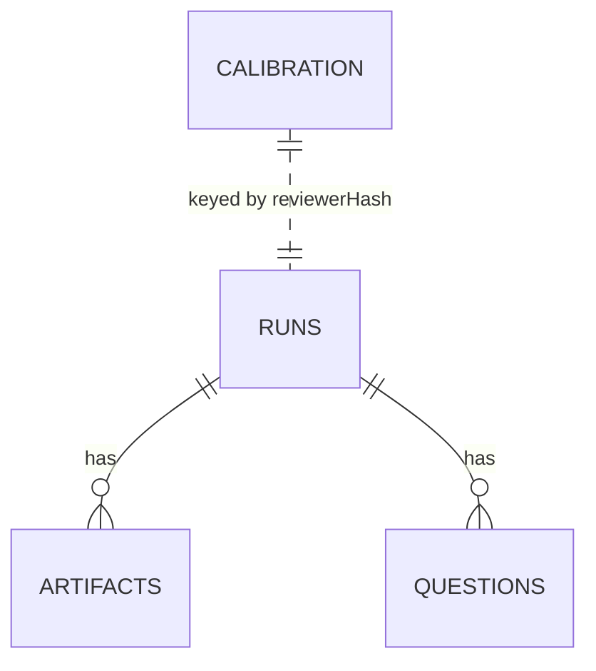

# RippleWitness — Architecture

| | |
|---|---|
| Version | 1.2 (revised 4 Nov 2026) |
| Style | Local-first, single-user, modular monolith in a TypeScript monorepo, plus an optional locked hosted demo |
| Companion | `TRD.md` (requirements and algorithms), `AGENTS.md` (agent specs) |

---

## 1. System context



Trust boundaries: (1) browser ↔ server is localhost only in the local product; (2) **BaseApp/HeadApp run untrusted, agent-written code** inside the replay sandbox; (3) the primary Meta Model API and an optional same-origin/loopback fallback receive only minimal redacted prompt content; no arbitrary remote fallback provider is allowed.

Two run shapes share the same server and UI. **Local mode** (the product) takes any local git repo path. **Hosted demo mode** (`RIPPLEWITNESS_LOCKED_RUN`, baked into the Docker image) ignores client-supplied subject fields, forces the prepared `typicode/json-server` change, seeds one completed run at boot, rate-limits analysis, and carries no shared Meta key unless the host configures one. It is a judge-facing demonstration, not a public arbitrary-repo service.

## 2. Containers and components



### Responsibilities

| Package | Owns | Must not |
|---|---|---|
| `core` | Types, zod schemas, node-status fusion, gate scoring, severity ranking | Do I/O |
| `graph` | Static graph for a given tree (base/head), impact paths; TS/JS via ts-morph, Python via stdlib `ast`, Go via stdlib parser | Execute code |
| `replay` | Worktrees, process lifecycle, scenario runner, normalizer, differ, flake guard | Call LLMs |
| `crossexam` | Claim types, **deterministic verifiers**, question templates/ranking, ask loop state machine | Let LLM output decide verdicts |
| `agents` | Meta API client (reasoning-capped, error-naming repair, fallbacks, cache), Muse Code adapter, prompt templates | Hold business rules |
| `receipt` | Normalized diff hash, HMAC/ed25519 signature, best-effort git notes, verification | Touch network |
| `canary` | TypeScript mutation operators, execution validation using the subject's own start command | Write mutated code into the subject repo, index, or any branch |

## 3. Pipeline (one review run)

Two observation surfaces feed the same fusion: **HTTP scenarios** (routes) and **compute scenarios** (named functions with fixture args, F-23), plus harvested tests as a scenario source (F-24). The differ is pluggable per path — deep-equal by default, tolerance-based for numeric/ML outputs (F-21) — and every child runs under determinism interposition (F-22). Assurance is tiered (L0 static → L3 full fusion); the tier is shown in the UI and bound into the receipt together with model/dataset artifact hashes (F-25).

```mermaid
sequenceDiagram
  participant UI
  participant API
  participant Orch
  participant Graph
  participant Replay
  participant CX as CrossExam
  UI->>API: POST /api/analyze (repo, refs, scenarios, options)
  API->>Orch: 202 {runId}; client polls status
  Orch->>Graph: extract(head) or import external graph; impact paths
  Orch->>Replay: worktrees + start apps (:8101/:8102) + run scenarios
  Replay-->>Orch: route observations (+ volatile flags)
  Orch->>Orch: fuse to node statuses (observed fields redacted until lock)
  Orch->>CX: build + rank evidence-anchored questions
  Note over UI,CX: After lock, agent-message feeds the agent summary to the<br/>claim extractor; verdicts are computed in code, then<br/>contradiction questions are added.
```

Stages run with timeouts; failure of one stage degrades only dependent panels (§9).

## 4. Cross-examination sequence



## 5. Gate state machine



**Invariants (server-enforced):**
1. Observed data is never sent to the client before the lock: `GET /api/runs/:id/map` pre-lock returns only `routeId, staticImpacted, inDiff, exercised` (no status, no observed outcome; QUIET nodes are **not** omitted, so absence cannot leak a SURPRISE).
2. Claims, questions, reveal, report and receipt return HTTP 423 until the prediction is locked (anti-anchoring); AI review additionally 423s until human findings exist (blind-first).
3. A prediction is scored against the stored fused observations; relocking with a different payload 409s, and a new head SHA starts a new run.

## 6. Data flow and storage

| Data | Location | Retention |
|---|---|---|
| Runs, stage states, predictions, scores, questions, pipeline intermediates (graph, fused routes, claims, receipt, observations) as JSON `artifacts` rows | `$RIPPLEWITNESS_HOME/runs.db` (SQLite) | Until deleted |
| Worktrees | `$RIPPLEWITNESS_HOME/wt/` (per-run subdirs) | Analysis worktrees removed when the stage ends; replay worktrees removed on replay completion |
| LLM cache | `$RIPPLEWITNESS_HOME/cache/` | Until the reviewer clears it |
| Receipt keys | `$RIPPLEWITNESS_HOME/key` (HMAC, 0600), `$RIPPLEWITNESS_HOME/signing.key` (0600) + `signing.pub` | Local; ephemeral in the free hosted demo |
| Receipts | Signed `receipt` artifact in SQLite + best-effort `git notes --ref=refs/notes/ripplewitness` (identity supplied per invocation; a note failure never blocks issuance) | Artifact with the run; note with the subject repo when writable |
| Scenario fixtures | `demo/scenarios/` (committed; scenarios-py/go beside them) | Versioned |

## 7. Repository layout

```
ripplewitness/
├─ apps/
│  ├─ web/                 # React + Vite (pages, JudgeGuide side panel)
│  └─ server/              # Express REST, pipeline, receipts, ablation, fn-run, forge
├─ packages/
│  ├─ core/  graph/  replay/  crossexam/  agents/  receipt/  canary/
├─ demo/
│  ├─ shop-api/  shop-api-js/  shop-api-py/  shop-api-go/
│  ├─ scenarios/  scenarios-js/  scenarios-py/  scenarios-go/
│  └─ prs/  prs-js/  prs-py/  prs-go/   # hand-authored patches + ground-truth labels
├─ eval/                   # harness + results.md
├─ docs/                   # spikes/, DEMO, HOSTING, real-repo run, submission notes
├─ ci-action/              # F-13 CI receipt verifier (zero-dependency)
├─ Dockerfile  render.yaml  docker-compose.yml   # locked hosted demo
└─ .github/workflows/ci.yml
```

## 8. Architecture decision records

| ADR | Decision | Alternatives considered | Reason |
|---|---|---|---|
| 001 | All-TypeScript pnpm monorepo | Python backend | One language, shared zod types, fastest in 3 days |
| 002 | `ts-morph` for static graph | tree-sitter; wrap code-review-graph | Type-resolved edges for TS; fewer moving parts; avoids dependency on an external 30-tool server; optional importer later |
| 003 | Differential replay of curated scenarios | Map test coverage; replay production traffic | Deterministic, no prod data; coverage limits made explicit via UNVERIFIED |
| 004 | Execution-graded gate | LLM-graded quiz | Quizzes are commoditized and gameable; ground truth is checkable |
| 005 | LLM for extraction/explanation only | LLM judge for verdicts | Prevents hallucinated verdicts and self-preference bias |
| 006 | Local-first, no auth | Hosted service | Source stays local; hackathon scope |
| 007 | SQLite for state, JSON for fixtures | Postgres | Zero setup |
| 008 | `muse exec --json` first; SDK/`serve` adapter not built | MCP bridge; scrape CLI | SDK surface never verified (S-01); no code written against guesses (AGENTS A6) |
| 009 | Receipt = HMAC default + ed25519 option, CI verifies both (M-08) | HMAC-only | ed25519 separates minting from verification; HMAC kept as the zero-setup default |
| 010 | Canary in view layer, validated by execution | Planting in the repo | Safety: never risk a planted bug being committed |
| 011 | Plain-table blast map (no graph lib) | React Flow + dagre; Cytoscape | 150-node table renders in ms; zero graph deps; E2E-08 gates perf |
| 012 | Server-side redaction of observed statuses in predict mode | Client-side hiding | Prevents trivial bypass |
| 013 | Locked hosted demo as a separate run shape, not a public multi-tenant service | Public arbitrary-repo hosting | The server executes subject code without container-grade per-user isolation; forcing one prepared subject keeps the judge demo safe and reproducible |
| 014 | Auto-load the nearest `.env` at CLI/server startup; cap Muse Spark reasoning (`reasoning_effort=minimal`, 3,000-token default budget) | Require shell-exported env; 1,000-token budget | A sourced-but-unexported `.env` silently disabled every LLM feature; uncapped reasoning returned empty content on real prompts (observed live) |

## 9. Failure modes and degradation

| Mode | Badge | What still works |
|---|---|---|
| Replay failed | `STATIC-ONLY` | Diff, static map; **gate disabled** (cannot grade) |
| Static pass finds no routes | `DYNAMIC-ONLY` | Replay-observed statuses only (CHANGED / UNCHANGED / UNCOVERED); no SURPRISE is claimed without static evidence |
| LLM unavailable | `NO-LLM` | Replay, map, gate, deterministic questions, receipt. Claim extraction, AI review, summary, and explanation return `503 no_llm`; `/api/config` reports `capabilities.llm=false` so the UI says why |
| Muse Code unavailable | `NO-AGENT` | Everything except live Q&A; questions stay OPEN rather than being answered by a substitute |
| Stub Q&A (tests / hosted demo) | `AGENT-REINSTANTIATED` | Scripted answers labelled as a demo stub in the UI; receipt records the answer mode, never `live_session` |

## 10. Quality attributes

| Attribute | Tactics |
|---|---|
| Determinism | Frozen clock, seeded IDs, DB copies per group, base double-run flake guard |
| Security | Restricted subprocess, no tools in LLM calls, schema validation, secret redaction |
| Performance | Parallel static + replay stages, graph cached by tree hash, LLM cache |
| Observability | JSON logs with `runId`; token/cost counters in footer |
| Testability | Pure `core`; ports/adapters for Muse Code and Meta API (fakes in tests) |
| Extensibility | Verifier registry, mutation-operator registry, language extractor interface (future) |

## 11. Extension points

- `LanguageExtractor` interface — **implemented (F-18/F-20, Epic J)**: one extractor per subject language, each emitting the identical deterministic graph JSON (`route:`/`fn:`/`db_table`/`config` nodes; see TRD §7.1). Implementations: ts-morph for TS/JS (same engine, `allowJs` fallback — F-18), a stdlib-`ast` Python script invoked as a child process (F-20; zero new dependencies, output zod-validated like every external input), and a stdlib-only Go program over `go/parser` for `net/http` servers (M-07; `GOCACHE` pinned under the run dir, no interposition available). The pipeline selects by detected subject language; everything past the graph (fusion, gate, questions, receipt) is language-blind by construction. Adding a language = one extractor + one lifecycle row in TRD §7.2, nothing downstream.
- **Implemented (M-11):** external graph import — `POST /api/analyze` accepts `externalGraph` (zod-validated, integrity-checked, 1k-node/4k-edge caps); the pipeline skips the built-in extractor and records `graphSource: external`.
- **Implemented (M-08):** dual-algorithm receipts — `signReceipt` (HMAC) and `signReceiptEd` (ed25519) over the same canonical payload; `verifyReceiptAny` dispatches on shape; CLI `verify --public-key` and the CI action verify both.
- Replay `TrafficSource`: curated scenarios + HAR import (`ripplewitness import-har`, M-10; secrets stripped, error/foreign entries skipped). Live traffic capture remains unbuilt.

## 12. Runtime process model

| Process | Port | Lifetime |
|---|---|---|
| RippleWitness server (Express; the web UI is the separate Vite dev server) | 4400 | long-running |
| Web dev server (Vite) | 5173 | dev only |
| Web preview (hosted Docker image) | `$PORT` (7860 default; Render injects its own) | long-running, proxies `/api` to 4400 |
| Base app (subject repo @ base) | 8101 (falls back to a free port) | per replay side |
| Head app (subject repo @ head) | 8102 (falls back to a free port) | per replay side |
| Third/canary/ablation app instances | free ports | per drill / ablation |

Configuration: the CLI/server auto-loads the nearest `.env` found by walking up from the working directory (shell-exported values win; blank values count as unset), then `ripplewitness.config.yaml` under `$RIPPLEWITNESS_HOME`. `GET /api/config` exposes only non-secret shape: the locked run (if any) and capability flags (`llm`, `agentSession`).

Concurrency: local analyses are fire-and-track (the API does not serialize per-repo); replay runs base fully, then head, with scenario groups sequential within a side. Hosted locked mode additionally caps analysis at 6/hour/IP and 2 concurrent runs, with a 600-requests/5-min/IP API ceiling. Every spawned child is tracked in a `ProcRegistry` and killed at stage end; the server installs no signal handlers.

## 13. Persistence model



Four tables (`runs`, `artifacts`, `questions`, `calibration`); pipeline
intermediates are JSON `artifacts` rows keyed by `kind`. DDL: `TRD.md` §6.1.

## 14. Operating limits

| Limit | Value | On exceed |
|---|---|---|
| Diff size | Parser keeps 100 files × 2,000 lines/file (`DIFF_MAX_FILES`, `DIFF_MAX_LINES_PER_FILE`) | Files truncated in the diff view; no analysis-stage size cap |
| External graph import (M-11) | 1,000 nodes / 4,000 edges | `POST /api/analyze` → 400 |
| Scenario suite | No count cap; each step has a 15 s timeout (`stepTimeoutMs`) | A stuck step times out and marks its route volatile |
| LLM calls per run | 25 (`META_MAX_CALLS_PER_RUN`; 0 = unlimited) | Later LLM stages degrade (`MetaDegraded`); deterministic core continues |
| LLM output budget | 3,000 tokens/call default with `reasoning_effort=minimal` (`META_REASONING_EFFORT` overrides) | Uncapped Muse Spark reasoning consumed the whole budget and returned empty content on real prompts (observed live) |
| Hosted demo analysis | 6/hour/IP, 2 concurrent, 600 API requests/5 min/IP | `429 rate_limited` / `429 busy` |
| Static pass finds 0 routes (any language) | `DYNAMIC-ONLY` badge; inventory from scenarios + `__routes` | Gate unaffected (observed-only) |
| Questions asked of the agent | ≤ 5 per review; ≤ 3 asks per question (initial + 2 follow-ups) | Further asks return 429 |

## 15. Demo-repo coupling design (hero PR)

The subject app uses an in-process **string-keyed event bus** (`bus.emit('discount.applied', …)` in checkout; `bus.on('discount.applied', …)` in reports, which updates `sales_summary`). The static extractor deliberately does **not** resolve string-keyed dispatch (events, feature flags, reflection, dynamic imports) — a limitation shared by most static analyzers and documented in the README. Muse Code's VIP-discount PR touches checkout and emits the event; replay observes `/reports/sales` changing; the fusion step labels it **SURPRISE**.

Disclosure rules: the coupling is authored into the demo repo; the PR catalog is author-designed; E2 is reported as an existence proof, not prevalence.
