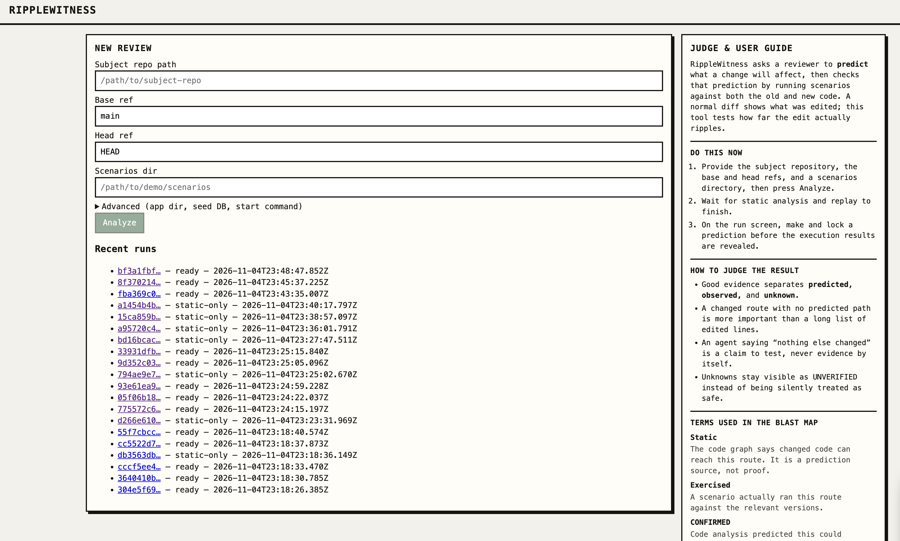
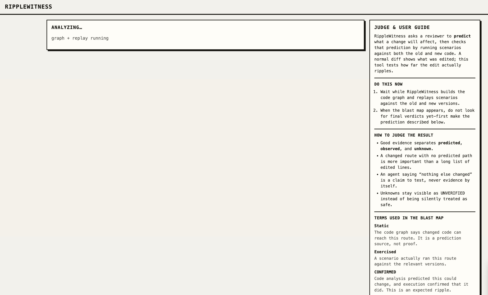
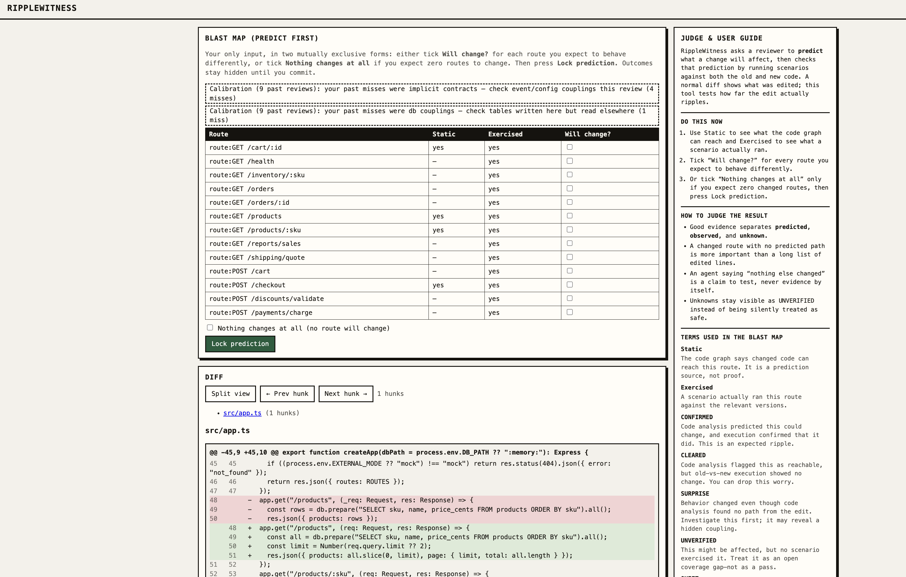
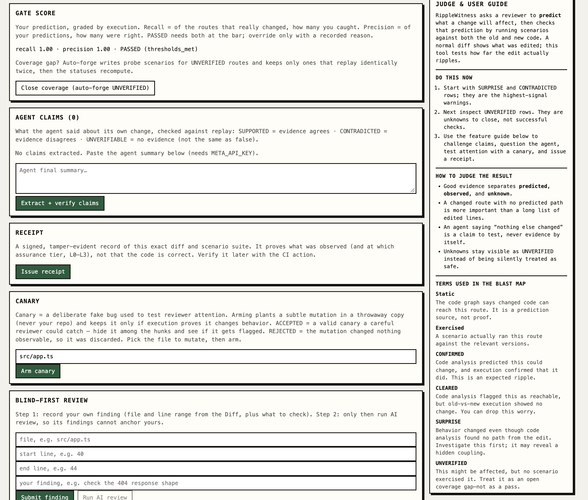
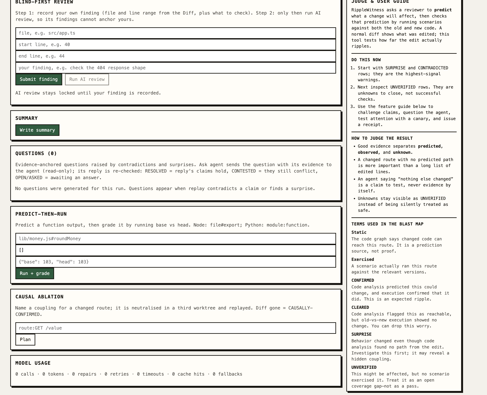

# RippleWitness

> **Live demo for judges:** [https://ripplewitness.onrender.com/](https://ripplewitness.onrender.com/) — a locked, one-click showcase running the real `typicode/json-server` review. No setup needed: open the prepared run, lock a prediction, and see the graded reveal. (Free-tier hosting: ~1 min cold start after idle; local runs below are the full tool.)

## The problem

AI coding agents write bigger diffs than any human can carefully review. The
agent's summary says *"only touches checkout"* — and the review becomes a
skim of edited lines plus trust in that sentence. But a diff shows what was
edited, not what changed. The checkout edit can quietly move
`/reports/sales` through a shared helper, an event bus, or a config value,
and nothing in the diff tells you to look there.

## The proposed solution

RippleWitness is a local-first review cockpit that checks the change by
running it, not by reading the agent's summary. Point it at a subject repo
and two refs; it builds a static impact graph, replays a scenario suite
against both versions, and fuses the two into an observed blast radius: what
actually behaved differently. Before any of that is revealed, *you* predict
the impact set — the gate scores your prediction against execution. Agent
claims become checkable statements, questions carry their evidence, and the
finished review is sealed in a tamper-evident receipt bound to the exact
diff. All verdicts, scores, and statuses are computed in deterministic code;
the LLM only extracts claims, phrases questions, and explains.

Built for the Meta Global AI Developer Hackathon (Indie track). Numbers in
this file come only from `pnpm eval` — see
[eval/results.md](eval/results.md).

## Why this matters

The agent says *"only touches checkout."* RippleWitness doesn't grade the
sentence — it replays the change and checks. On the hero PR (PR-00),
execution shows `/reports/sales` changed too, through an event-bus coupling
the static map cannot see. The reviewer had to predict the blast radius
*before* that reveal; the prediction is scored against execution, and the
resulting receipt is bound to the exact diff.

| Claim | Execution said | Proof |
|---|---|---|
| "Only touches checkout" (PR-00) | **CONTRADICTED** — `/reports/sales` moved via the dormant `discount.applied` subscriber | [eval/results.md](eval/results.md) E1/E3 (verifiers 20/20) |
| Static map = the impact set | Map alone: precision 0.40, recall 0.53 — useful, not ground truth | [eval/results.md](eval/results.md) E1 |
| "Nothing else changes" is checkable | Replay matched designed behavior on 7/8 catalog PRs; the 8th is the documented PR-00 coupling | [eval/results.md](eval/results.md) E1 |
| Works on code we didn't write | Real upstream fix in `typicode/json-server`: predicted exactly the 404 change; gate 1.00/1.00; ed25519 receipt `VALID` in CI mode | [docs/real-repo-run.md](docs/real-repo-run.md) |
| UNVERIFIED is a to-do, not a dead end | Forge loop synthesized `GET /products`, flipped UNVERIFIED → CONFIRMED live | [docs/forge-live-run.md](docs/forge-live-run.md) |

## Scope — what repos it can review

| Subject | Static graph | Differential replay | Demo fixtures |
|---|---|---|---|
| Node + TypeScript | Express-family routes, `Router` prefixes, call/db/config edges | Start-command discovery, frozen clock + seed | `demo/shop-api`, `demo/scenarios`, `demo/prs` |
| Plain JavaScript (Node) | Same extractor with `allowJs` | Same as TypeScript | `demo/shop-api-js`, `demo/scenarios-js`, `demo/prs-js` |
| Python | FastAPI decorators, Flask routes + blueprints | `.venv` install, `PYTHONHASHSEED=0`, frozen-time shims | `demo/shop-api-py`, `demo/scenarios-py`, `demo/prs-py` |
| Go | `net/http` handle patterns, method + param routes | `go run` start; no clock freeze, no compute scenarios | `demo/shop-api-go`, `demo/scenarios-go`, `demo/prs-go` |
| Anything else | `externalGraph` import, or dynamic-only mode | HTTP replay wherever a start command + scenarios exist | n/a |

Language is auto-detected from `package.json`/`tsconfig.json`,
`requirements.txt`/`pyproject.toml`/`setup.py`, or `go.mod` (see
[packages/graph/src/language.ts](packages/graph/src/language.ts)). Unsupported
stacks can still be reviewed through a precomputed graph
([packages/graph/src/external.ts](packages/graph/src/external.ts)) or in
dynamic-only mode (scenario inventory instead of a static pass). Replay needs
a bootable app, an HTTP surface, and a seed database (`seed/seed.db` by
default) — the subject contract is
[`demo/shop-api`](demo/shop-api) itself: frozen clock, seeded ids, mocked
externals.

## Features — what each one does

### Observed Blast Radius

RippleWitness combines a static call/db/config graph with differential replay of a curated scenario suite.

Every route receives exactly one computed status:

- **CONFIRMED** — static analysis and replay both indicate that the route changed.
- **CLEARED** — the route is reachable, but execution shows no observable change. You can stop worrying about it.
- **SURPRISE** — the route changed even though the static graph found no path from the edit. This deserves investigation.
- **UNVERIFIED** — the route might be affected, but no scenario exercised it. This remains an open gap, never a pass.
- **QUIET, DIFF, or CONTRADICTED** — additional computed statuses used to represent the corresponding analysis and comparison outcomes.

**Why this matters:** Instead of spending most of your review looking through edited lines, you can focus on the behavior that actually changed. Just as importantly, anything that hasn't been verified stays visible rather than being silently treated as safe.

Core implementation: [`packages/core`](packages/core), [`packages/graph`](packages/graph), and [`packages/replay`](packages/replay).

Benchmark: [`eval/results.md`](eval/results.md) E1.

### Predict-the-Ripple Gate

Before seeing the execution results, you select the routes you expect to behave differently. You can also explicitly predict that nothing will change.

Once you're happy with your prediction, you lock it. Only then are the actual outcomes revealed.

The tool calculates precision and recall against execution results. Missed changes are also classified by cause, and if the prediction gate fails, it can only be overridden with a recorded reason.

**Why this matters:** You have to make your own assessment before seeing what the tool found. This helps prevent its verdicts from influencing your initial judgment, while also giving you an honest measure of what you missed.

See the [demo beats](docs/DEMO.md).

### Cross-Examination Engine

Paste the coding agent's summary into RippleWitness, and it extracts claims that can be checked against execution evidence.

These claims are grouped into five categories:

- `SCOPE`
- `BEHAVIOR_UNCHANGED`
- `IMPLEMENTED`
- `TESTS`
- `API_COMPAT`

Each claim is checked deterministically against replay evidence and receives one of three verdicts: SUPPORTED, CONTRADICTED, or UNVERIFIABLE.

The seeded-claim evaluation achieved 20/20 verification results (eval E3).

When RippleWitness finds a contradiction or a surprising change, it turns the finding into a question backed by evidence. You can use **Ask agent** to send that question, along with its supporting evidence, to a read-only agent session.

The agent's response is then checked again and classified as RESOLVED, CONTESTED, or OPEN.

The important distinction is that the agent's response is never treated as proof. It's another claim that needs to be verified.

**Why this matters:** Statements like "nothing else changed" become something you can actually test instead of something you simply have to trust.

Implementation: [`packages/crossexam`](packages/crossexam).

### Review Receipt

Once the review is complete, RippleWitness generates a signed record tied to the exact diff (resolved SHAs) and scenario suite.

It supports HMAC by default and ed25519 when requested. The receipt is attached using a `RippleWitness-Receipt:` trailer and stored in git notes.

You can verify it later using:

- `ripplewitness verify`
- The pre-push hook
- The zero-dependency CI action in [`ci-action/`](ci-action)

Assurance tiers L0–L3 indicate how much evidence supports the review.

**Why this matters:** A review shouldn't just leave behind a green checkmark that nobody can explain later. The receipt records what was actually observed and the assurance tier at which the review was completed.

### Blind-First AI Review

Before the AI reviewer runs, you must record your own finding. Each finding includes a file, a line range, and a note.

The AI reviewer then produces its findings, which are validated against the diff's line ranges.

**Why this matters:** You still get another set of eyes on the code, but the AI doesn't get to make the first call for you.

### Canary Hunks

RippleWitness can deliberately introduce a subtle fake bug into a throwaway copy of the repository. Your actual repository is never modified.

The mutation is kept only if execution confirms that it produces an observable behavioral change.

- **ACCEPTED** means the mutation creates a real, observable change that a careful reviewer could potentially catch.
- **REJECTED** means the mutation was discarded because it didn't produce an observable change.

**Why this matters:** It's a way to test how carefully someone reviews code, similar to how a fire drill tests whether people notice and respond to an emergency.

Validation: [`packages/canary`](packages/canary).

Evaluation: [`eval/results.md`](eval/results.md) E5.

### Explainer and Evidence-Only Summary

RippleWitness provides plain-language explanations for individual diff hunks, connecting each change to the observed behavior.

It also generates a PR summary using only the diff and execution observations. It never relies on the coding agent's own description of its work.

Routes that weren't exercised are listed explicitly.

**Why this matters:** Anyone reviewing the PR later can understand what was actually observed, rather than having to rely on what the agent claimed to have done.

### Closing the gaps

An UNVERIFIED route isn't something RippleWitness simply leaves behind. The tool also provides ways to investigate and reduce these coverage gaps.

Some of the available approaches include:

- **Scenario forge:** Synthesizes probe scenarios and keeps only those that replay deterministically. See [docs/forge-live-run.md](docs/forge-live-run.md).
- **HAR import:** `ripplewitness import-har` converts recorded HTTP traffic into replayable scenarios.
- **Causal ablation:** Neutralizes a suspected coupling in a third worktree to help establish whether it caused the observed change.
- **Predict-then-run:** Checks a predicted function output against base-vs-head execution.
- **ML support:** ML subjects get tolerance-aware diffs, compute scenarios, pytest harvesting, and artifact hashing.

**Why this matters:** Coverage gaps become concrete tasks that can be investigated and resolved, rather than accumulating unnoticed.

### PR Report and Model Usage

`GET /api/runs/:id/report` generates the completed review as PR-comment markdown.

The run footer also shows exactly how the model was used, including calls, tokens, repairs, and retries. If no model calls were made, it reports `NO-LLM` instead.

All deterministic functionality works without `META_API_KEY`.


## Quickstart

Prerequisites: **macOS or Linux**, Node 22+, git, and `corepack` (ships with
Node). Windows is not supported (symlinked dependency trees and
process-group teardown assume POSIX). The first `corepack pnpm i` needs
network; after that, everything below runs locally.

```sh
corepack pnpm i
corepack pnpm demo             # hero subject + server :4400 + web :5173
```

(`pnpm demo` prepares the PR-00 scratch repo and prints the exact New
review fields; beats in [docs/DEMO.md](docs/DEMO.md). Prefer manual
control? `corepack pnpm demo:prepare && corepack pnpm dev` — the manual
subject setup for `/tmp/demo-subj` is also in
[docs/DEMO.md](docs/DEMO.md).)

Open [http://127.0.0.1:5173](http://127.0.0.1:5173), review, predict, lock,
reveal. Without `META_API_KEY`, everything deterministic works (map, replay,
gate, questions, receipt); LLM assistants honestly report `NO-LLM` mode.
Reviewer config is optional: drop a `ripplewitness.config.yaml` in
`$RIPPLEWITNESS_HOME` or the server's working directory — unknown keys fail
fast at startup.

## Test your own repo (step by step, local)

Uses `pnpm dev` (server `:4400` + web `:5173`). Your repo stays untouched —
RippleWitness reviews it from throwaway worktrees.

```sh
corepack pnpm i
corepack pnpm dev        # leave running; open http://127.0.0.1:5173
```

1. **Commit both sides.** Your subject must be a git repo with the change
   committed: a base ref (e.g. `main`) and a head ref (e.g. your PR
   branch or `HEAD`).
2. **Make it replayable.** The app must boot over HTTP with a start
   command (default: `package.json` start) and a seed DB at
   `seed/seed.db` (override in Advanced). See the subject contract in
   [Scope](#scope--what-repos-it-can-review); the
   [json-server run](docs/real-repo-run.md#harness-disclosed-identical-on-both-sides)
   shows the minimal harness for a repo that lacks one.
3. **Prepare scenarios.** A directory of JSON request probes (one file
   per scenario). Copy the shape from
   [`demo/scenarios`](demo/scenarios), or convert recorded traffic with
   `ripplewitness import-har`.
4. **New review.** In the web UI, fill Subject repo path, Base ref, Head
   ref, Scenarios dir; expand Advanced only if you need App dir, Seed DB
   path, or Start command. Press **Analyze**.
5. **Predict, lock, reveal.** Tick the routes you expect to change (or
   **Nothing else changes**), **Lock prediction**, then read the graded
   blast radius, claims, questions, and receipt.
6. **LLM features (optional).** Set `META_API_KEY` before `pnpm dev` for
   claim extraction, Q&A, and summaries; without it the deterministic
   core works and LLM stages report `NO-LLM`.

```sh
corepack pnpm lint && corepack pnpm typecheck
corepack pnpm test             # unit (fast, no network)
corepack pnpm test:int         # integration (spawns servers; needs localhost)
corepack pnpm test:e2e         # Playwright browser suite (E2E-01..08, E2E-11)
corepack pnpm eval             # benchmark -> eval/results.md (~3 min)
```

## Repository structure

```
ripplewitness/
├─ apps/
│  ├─ web/                 # React + Vite cockpit (pages, JudgeGuide side panel)
│  └─ server/              # Express REST, pipeline, receipts, ablation, fn-run, forge
├─ packages/
│  ├─ core/                # fusion statuses, scoring, prediction gate (pure logic)
│  ├─ graph/               # TS/JS + Python + Go static extractors, external import
│  ├─ replay/              # differential replay sandbox, diffing, flake guard
│  ├─ crossexam/           # claim verifiers, evidence-anchored questions
│  ├─ agents/              # Meta Model API client + in-product agent prompts
│  ├─ receipt/             # HMAC/ed25519 receipts, git notes, verification
│  └─ canary/              # execution-validated mutation planning
├─ demo/
│  ├─ shop-api/  shop-api-js/  shop-api-py/  shop-api-go/   # subject apps
│  ├─ scenarios/  scenarios-js/  scenarios-py/  scenarios-go/
│  └─ prs/  prs-js/  prs-py/  prs-go/   # hand-authored patches + ground truth
├─ eval/                   # benchmark harness + results.md
├─ docs/                   # architecture, demo script, hosting, live-run evidence
│  └─ assets/              # screenshots used below
├─ ci-action/              # CI receipt verifier (zero-dependency)
├─ Dockerfile  render.yaml  docker-compose.yml   # locked hosted demo
├─ ARCHITECTURE.md         # system design, ADRs, data flow
└─ .github/workflows/ci.yml
```

Design detail: [ARCHITECTURE.md](ARCHITECTURE.md). Remaining planning docs
(`PRD.md`, `TRD.md`, …) live with the author, not in this repo.

## Screenshots

**1. New review** — repo path, base/head refs, scenarios dir, and the run
history. The side guide walks a first-time judge through the whole flow.



**2. Analyzing** — the static pass and base/head replay run; the gate opens
only when evidence is in.



**3. Predict first** — the blast map shows static reachability and exercised
coverage but hides outcomes. Tick what you expect to change, lock the
prediction, then reveal. The diff sits below for reference.



**4. Graded and sealed** — the gate score (recall/precision, PASSED or
MISSED with causes), agent-claims checking, the signed receipt, canary
arming, and blind-first review.



**5. The full cockpit** — blind-first AI review, evidence-only summary,
evidence-anchored questions with read-only agent Q&A, predict-then-run,
causal ablation, and the model-usage footer proving what ran.



## Limitations

Stated plainly, with backing:

- Replay verifies only **exercised** routes; anything else stays UNVERIFIED
  — a visible gap, not a pass. (Design: [ARCHITECTURE.md](ARCHITECTURE.md).)
- Full static+replay fusion covers TypeScript/JavaScript (Express-family),
  Python (FastAPI/Flask patterns), and Go (`net/http`); other stacks get
  dynamic-only or compute coverage at best. Auth, multi-step, and external
  flows still need scenarios or recorded traffic
  (`ripplewitness import-har`).
- The static extractor is heuristic (name-based inferred edges, regex SQL
  tables) and cannot see string-keyed dispatch (event buses, feature
  flags), dynamic imports, or reflection — the deliberate
  `discount.applied` coupling in `demo/shop-api` exists to prove that
  execution catches what the map misses.
- The evaluation is small: 42 scenarios, 8 catalog PRs (7/8 replay match),
  20 seeded verifier claims (20/20) — indicative, not statistically
  conclusive. The PR catalog is author-designed, so surprise findings are
  an existence proof, not a prevalence estimate. See
  [eval/results.md](eval/results.md).
- Receipts are tamper-evident locally, not tamper-proof; re-instantiated
  agent answers are labeled as such, never presented as the live agent's.
- Local, single-user tool on macOS/Linux — no auth, no Windows. The hosted
  demo is a locked single-subject showcase with ephemeral storage; see
  [docs/HOSTING.md](docs/HOSTING.md).

## Future scope

Directions this could grow, none of them promised:

- **More frameworks and languages** — generalize the extractor interface
  and harden `externalGraph` so new stacks plug in without touching the
  pipeline.
- **Recorded-traffic-first reviews** — deeper HAR/import flows so teams
  bring production coverage instead of hand-writing scenarios.
- **Human trials** — measure canary catch rates and whether the gate
  actually moves downstream defect rates; today we measure prediction
  accuracy and verification outcomes only.
- **CI-native enforcement** — grow the pre-push hook and
  [`ci-action/`](ci-action) into branch protection with tier policies.
- **Multi-user deployments** — auth, run sharing, and hosted persistence
  beyond the current locked demo.

## Key links

- [ARCHITECTURE.md](ARCHITECTURE.md) — system design, ADRs, data flow
- [docs/DEMO.md](docs/DEMO.md) — the 2-minute demo script and manual setup
- [docs/real-repo-run.md](docs/real-repo-run.md) — third-party code run
  (json-server), verbatim evidence
- [docs/forge-live-run.md](docs/forge-live-run.md) — UNVERIFIED →
  CONFIRMED forge loop, live evidence
- [eval/results.md](eval/results.md) — benchmark numbers behind every
  claim above
- [docs/HOSTING.md](docs/HOSTING.md) — deploying the locked demo
- [docs/bugs.md](docs/bugs.md) — bug log with severities and regression
  tests
- [docs/spikes/](docs/spikes) — resolved unknowns (agent session, model
  API, replay sandbox, submission rules)
- [docs/SUBMISSION.md](docs/SUBMISSION.md) — submission checklist
